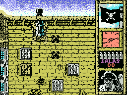
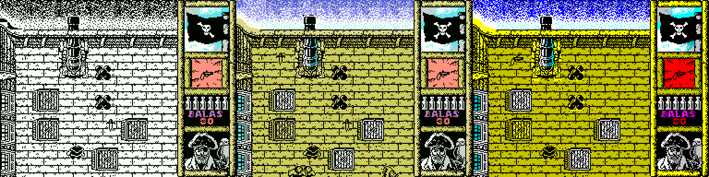

# Black Beard Enhanced (MSX)

[Español](README.md) · **English** · [日本語](README.ja.md)

An enhanced version of **Black Beard** (Topo Soft, 1988) for MSX, built from a complete disassembly of the original game. It runs almost twice as smoothly as the original, the play area has the colours of the ZX Spectrum version, and the screen scrolls with the player.



## What's new

* **Almost twice as fast**, at a steady 10 game loops per second: a loop goes from 9.30 to 5.25 frames on average (−44 % time, +77 % loops per second). A frame limiter keeps the same speed on MSX1, MSX2 and turbo R.
* **Play area in colour**, using the attributes of the Spectrum version. The original computed them but left the play area black and white.
* **Colour sprites** under the characters (light red for the enemies, cyan for the pirate) that stay in place with their figure.
* **Scrolling that follows the player**: pixel by pixel vertically and 8 pixels at a time horizontally, with a 72x72 central area where the screen stays still. No hiccups when the map moves to a new tile.
* **Hidden page on MSX2, MSX2+ and turbo R**: the new screen appears all at once. On turbo R it uses the R800 and the camera follows every step.
* **Recoloured status panel** by araubi.
* **Stairs without pressing fire**: just step on them.
* **Language option in the menu**: Spanish or English (texts of the Kixx edition, with its English corrected).
* **Music with the Amstrad CPC tuning**, the one the composer, César Astudillo "Gominolas", considers right.
* **Visible potion**: the pirate turns green while it lasts and blinks before it runs out.
* **Cannon blast**: a new sound when firing, and the camera no longer prevents the shot.
* **64 KB ROM (ASCII16)** that openMSX and BlueMSX detect on their own.



## Downloads

In [`releases/`](releases/):

| File | What it is |
|---|---|
| `BlackBeard_color.rom` | 64 KB ROM, ASCII16, in Spanish (switch to English with key 4 in the menu). |

It needs an MSX with 64 KB of RAM. The ROM has been tested in openMSX with MSX1 (HB-20P), MSX2 (HB-F900), MSX2+ and turbo R (FS-A1ST, FS-A1GT), at 50 Hz and 60 Hz.

## How to play

* **Keys:** cursor keys to move, **SPACE** to fire and **H** to pause. They can be redefined in the menu (3), and there is joystick support (2).
* **Menu:** 1 keyboard, 2 joystick, 3 define keys, **4 language**, 0 play.
* **Cheat from the original:** press **U, X, Y and Z together** during the game for infinite lives.

## How to build

You need **Python 3**, **sjasmplus 1.24.0** and, for the ROM, Einar Saukas' **zx0** compressor. The repository contains nothing from the original game: the graphics and the two BASIC loaders are taken from **your own tape**.

```sh
# 1. Extract the original files from your tape (their SHA-1 is checked)
python3 tools/extrae_originales.py "Blackbeard (1988)(Topo Soft)(ES)[RUN'CAS-'].cas"

# 2. Tapes (in src/)
cd src
python3 build.py              # the original, identical byte for byte (SHA-1 checked)
python3 build.py color        # Enhanced, Spanish -> BlackBeard_color.cas
python3 build.py kixx color   # Enhanced, starting in English

# 3. ROM (in src/rom/)
cd rom
python3 build_rom.py          # -> BlackBeard_color.rom
python3 build_rom.py kixx     # -> BlackBeard_kixx_color.rom
```

The `SJASMPLUS` and `ZX0` variables tell the scripts where the programs are. Other `build.py` options: `acelera` (speed-up only), `limite=N` (frames per loop, 5 by default), `salto=N` (vertical camera step), `musica_msx`, `marcador_original`, `sin_sprites` and `completo`. The built ROM gives the same SHA-1 as the one in `releases/`; the tapes and the Kixx ROM are not published, but they can be built.

## Repository layout

| Folder | Contents |
|---|---|
| `src/` | The commented disassembly (`cuerpo_*.asm`) and all the new code (`acelera.asm`, `color.asm`, `parcial.asm`, `filas.asm`, `scroll.asm`, `doble.asm`, `sprites.asm`...), with `build.py`. |
| `src/rom/` | The cartridge: `rom.asm`, `build_rom.py` and the ZX0 decompressor. |
| `src/herramientas/` | The scripts that produced the disassembly and generate tables and graphics. |
| `src/openmsx/` | openMSX scripts to test, profile and verify the screen. |
| `tools/` | Extraction of the original files, speed comparison and tests. |
| `docs/` | Technical documentation and lessons, in [Spanish](docs/es/), [English](docs/en/) and [Japanese](docs/ja/). |
| `images/` | Screenshots and the full maps of the four decks. |
| `releases/` | The built ROM. |

The source code comments and labels are in Spanish.

## Documentation

* [Technical documentation](docs/en/DOCUMENTATION.md): tape structure, memory map, curiosities of the original (an undocumented cheat, the colour that was never shown, a forgotten loader...) and how each improvement works.
* [Lessons](docs/en/LESSONS.md): what we learned, useful for other MSX games.

## Credits

* **Black Beard** (1988): Topo Soft, published by Erbe Software. Program: Carlos Arias Alonso. Graphics: Roberto Potenciano Acebes. Music: César Astudillo (Gominolas). Cover: Alfonso Azpiri. Support software: José Manuel Lazo.
* **Disassembly and enhanced version:** araubi (direction, testing, recoloured status panel and figure retouching). Developed with Claude (Anthropic).
* **ZX0:** Einar Saukas. `dzx0_standard` decompressor: Einar Saukas and Urusergi (BSD 3-Clause licence).

## Licence and notices

* **Own code and tools** (new code in `src/`, `src/herramientas/`, `src/openmsx/`, `tools/`): MIT licence, see [LICENSE](LICENSE).
* **Documentation, own graphics and retouches** (`docs/`, `src/graficos/`, the READMEs): CC BY-NC-SA 4.0, see [LICENSE-CC](LICENSE-CC). Retouches of game graphics cover only the retouch.
* **ZX0** (`src/rom/dzx0_standard.asm`): BSD 3-Clause licence, see [src/rom/LICENSE_ZX0.txt](src/rom/LICENSE_ZX0.txt).
* **The original game is not covered by these licences.** Black Beard, its code, graphics, music and texts belong to their authors and rights holders. The screenshots and maps in `images/` show the game and are not covered either. The disassembly in `src/` is published for study and preservation, and the ROM in `releases/` contains the modified original game: it is not covered by the licences above either.
* This is a non-profit tribute. No original file (tapes, ROMs or dumps) is included. It will be taken down if any rights holder asks.
