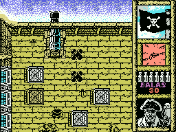
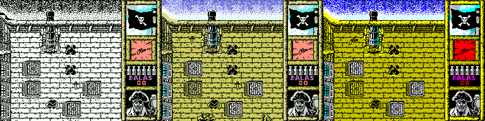

# Black Beard Enhanced (MSX)

[Español](README.md) · [English](README.en.md) · **日本語**

**Black Beard**（Topo Soft、1988年）の MSX 版を、オリジナルの完全な逆アセンブルをもとに改良したバージョンです。オリジナルのほぼ2倍なめらかに動き、プレイ画面は ZX Spectrum 版の色で表示され、画面はプレイヤーに合わせてスクロールします。



## 新しくなった点

* **ほぼ2倍の速さ**で、毎秒10ループの一定のテンポ。1ループは平均 9.30 フレームから 5.25 フレームに（時間 −44 %、毎秒のループ数 +77 %）。フレームリミッターにより MSX1・MSX2・turbo R で同じ速さになります。
* **プレイ画面がカラー**に。Spectrum 版の属性を使っています。オリジナルは色を計算していたのに、プレイ画面は白黒のままでした。
* キャラクターの下に**カラースプライト**（敵は明るい赤、海賊はシアン）。絵からずれません。
* **プレイヤーを追うスクロール**：縦は1ドット単位、横は8ドット単位。中央の 72x72 の範囲では画面は動きません。タイルが切り替わるときの引っかかりもありません。
* **MSX2・MSX2+・turbo R では裏画面を使用**：新しい画面が一度に表示されます。turbo R では R800 を使い、カメラが一歩ごとに追います。
* araubi による**ステータス表示の塗り直し**。
* **階段はボタン不要**：踏むだけで移動します。
* **メニューで言語を選択**：スペイン語または英語（Kixx 版のテキスト。英語の誤りを修正）。
* **Amstrad CPC の音程の音楽**。作曲者セサル・アストゥディージョ（Gominolas）が正しいと考える方です。
* **薬の効果が見える**：効いている間は海賊が緑になり、切れる前に点滅します。
* **大砲の発射音**：撃つときに新しい音が鳴り、カメラが発射を邪魔しなくなりました。
* openMSX と BlueMSX が自動で認識する **64 KB ROM（ASCII16）** 。**v1.1** からは、ローダーがどのメガロム方式（ASCII16、ASCII8、Konami SCC、Konami）を選んでも動きます。実機の **One Chip MSX（OCM）** で確認済み。



## ダウンロード

[`releases/`](releases/) にあります：

| ファイル | 内容 |
|---|---|
| `BlackBeard_color.rom` | **v1.1。** 64 KB ROM、ASCII16、スペイン語（メニューの 4 キーで英語に切り替え）。ローダーが ASCII8、Konami SCC、Konami として読み込んでも動きます。 |

RAM 64 KB の MSX が必要です。ROM は openMSX で MSX1（HB-20P）、MSX2（HB-F900）、MSX2+、turbo R（FS-A1ST、FS-A1GT）、50 Hz と 60 Hz で確認し、実機の One Chip MSX でも動作を確認しています。

### バージョン

* **v1.1**（2026-11-08）：起動時に、どのメガロム方式で読み込まれたかを調べ、その方式のレジスタでバンクを切り替えます。One Chip MSX（OCM）では SD から読み込むローダーがメガロム方式を推測します。SofaROM は ASCII8 と判断して ROM にパッチを当て、mglOCM は Konami と判断したため、v1.0 はロゴやローディング画面の後で止まっていました。ゲーム内容は変わりません。
* **v1.0**（2026-11-03）：最初の公開版（`build_rom.py solo_ascii16` でビルド）。

### One Chip MSX（OCM、SX-1、SM-X、Zemmix Neo など）で遊ぶには

いちばん確実なのは、**mglOCM** でメガロム方式を指定して読み込む方法です：`mglocm /f BLACKB~1.ROM`（ASCII16）。SofaRun/SofaROM の自動判定でうまくいかない場合は、ROM の種類を手動で ASCII16 にしてください。まず 3.58 MHz（F12）で試してください。

## 遊び方

* **キー：** カーソルキーで移動、**スペース**で発射、**H** でポーズ。メニュー（3）で変更でき、ジョイスティック（2）にも対応。
* **メニュー：** 1 キーボード、2 ジョイスティック、3 キー設定、**4 言語**、0 ゲーム開始。
* **オリジナルの裏技：** ゲーム中に **U・X・Y・Z を同時に押す**と残機が無限になります。

## ビルド方法

**Python 3**、**sjasmplus 1.24.0**、ROM には Einar Saukas の圧縮ツール **zx0** と **pasmo**（`multimapper.asm` 用）が必要です。このリポジトリにはオリジナルのゲームのファイルは一切含まれていません。グラフィックと2つの BASIC は**手持ちのテープ**から取り出します。

```sh
# 1. 手持ちのテープからオリジナルのファイルを取り出す（SHA-1 を確認）
python3 tools/extrae_originales.py "Blackbeard (1988)(Topo Soft)(ES)[RUN'CAS-'].cas"

# 2. テープ（src/ で）
cd src
python3 build.py              # オリジナル。1バイトも違わず再現（SHA-1 を確認）
python3 build.py color        # Enhanced スペイン語版 -> BlackBeard_color.cas
python3 build.py kixx color   # Enhanced 英語で開始

# 3. ROM（src/rom/ で）
cd rom
python3 build_rom.py          # -> BlackBeard_color.rom（v1.1）
python3 build_rom.py solo_ascii16   # -> v1.0 の ROM
python3 build_rom.py kixx     # -> BlackBeard_kixx_color.rom
```

プログラムの場所は環境変数 `SJASMPLUS`、`ZX0`、`PASMO` で指定します。`build.py` のその他のオプション：`acelera`（高速化のみ）、`limite=N`（1ループのフレーム数、標準は 5）、`salto=N`（縦カメラの移動量）、`musica_msx`、`marcador_original`、`sin_sprites`、`completo`。ビルドした ROM の SHA-1 は `releases/` のものと一致します（v1.1：9f0a0dd7…。v1.0 の ROM（be2b1f45…）に `multimapper.py` を適用すると `releases/` のものとまったく同じになります）。テープと Kixx 版 ROM は公開していませんが、ビルドできます。

## リポジトリの構成

| フォルダ | 内容 |
|---|---|
| `src/` | コメント付きの逆アセンブル（`cuerpo_*.asm`）と新しいコードすべて（`acelera.asm`、`color.asm`、`parcial.asm`、`filas.asm`、`scroll.asm`、`doble.asm`、`sprites.asm` など）、`build.py`。 |
| `src/rom/` | カートリッジ：`rom.asm`、`build_rom.py`、ZX0 の展開ルーチン。 |
| `src/herramientas/` | 逆アセンブルを作ったスクリプトと、表やグラフィックを生成するスクリプト。 |
| `src/openmsx/` | テスト・計測・画面検証用の openMSX スクリプト。 |
| `tools/` | オリジナルファイルの取り出し、速度比較、テスト。 |
| `docs/` | 技術資料と教訓。[スペイン語](docs/es/)、[英語](docs/en/)、[日本語](docs/ja/)。 |
| `images/` | 画面写真と4つの甲板の全体マップ。 |
| `releases/` | ビルド済みの ROM。 |

ソースコードのコメントとラベルはスペイン語です。

## 資料

* [技術資料](docs/ja/DOCUMENTATION.md)：テープの構造、メモリマップ、オリジナルの小ネタ（知られていない裏技、表示されなかった色、使われていないローダーなど）、各改良のしくみ。
* [教訓](docs/ja/LESSONS.md)：ほかの MSX ゲームにも役立つ、作業で学んだこと。

## クレジット

* **Black Beard**（1988年）：Topo Soft、販売 Erbe Software。プログラム：Carlos Arias Alonso。グラフィック：Roberto Potenciano Acebes。音楽：César Astudillo（Gominolas）。パッケージ絵：Alfonso Azpiri。サポートソフト：José Manuel Lazo。
* **逆アセンブルと改良版：** araubi（ディレクション、テスト、ステータス表示の塗り直し、キャラクターの修正）。Claude（Anthropic）を使って開発。
* **ZX0：** Einar Saukas。展開ルーチン `dzx0_standard`：Einar Saukas と Urusergi（3条項 BSD ライセンス）。

## ライセンスと注意

* **独自のコードとツール**（`src/` の新しいコード、`src/herramientas/`、`src/openmsx/`、`tools/`）：MIT ライセンス。[LICENSE](LICENSE) を参照。
* **文書、独自のグラフィックと修正**（`docs/`、`src/graficos/`、README）：CC BY-NC-SA 4.0。[LICENSE-CC](LICENSE-CC) を参照。ゲームのグラフィックへの修正は、修正部分のみが対象です。
* **ZX0**（`src/rom/dzx0_standard.asm`）：3条項 BSD ライセンス。[src/rom/LICENSE_ZX0.txt](src/rom/LICENSE_ZX0.txt) を参照。
* **オリジナルのゲームはこれらのライセンスの対象外です。** Black Beard のコード、グラフィック、音楽、テキストは作者と権利者のものです。`images/` の画面写真とマップもゲームを写したものなので対象外です。`src/` の逆アセンブルは研究と保存のために公開しており、`releases/` の ROM は改変したオリジナルのゲームを含むため、これも上記ライセンスの対象外です。
* 非営利のオマージュです。オリジナルのファイル（テープ、ROM、ダンプ）は含んでいません。権利者から要請があれば公開を取りやめます。
