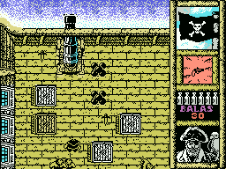
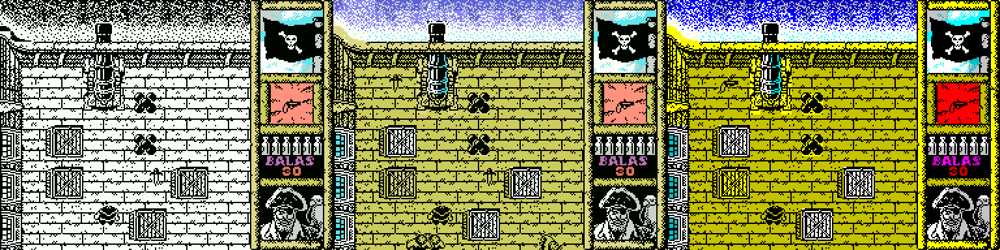

# Black Beard Enhanced (MSX)

**Español** · [English](README.en.md) · [日本語](README.ja.md)

Versión mejorada de **Black Beard** (Topo Soft, 1988) para MSX, hecha a partir de un desensamblado completo del juego original. Va el doble de fluida que el original, el área de juego tiene el color de la versión de Spectrum y el scroll sigue al jugador.



## Qué tiene de nuevo

* **Casi el doble de rápido**, a un ritmo fijo de 10 vueltas por segundo: la vuelta pasa de 9,30 a 5,25 cuadros de media (−44 % de tiempo, +77 % de vueltas por segundo). Un limitador hace que vaya igual en MSX1, MSX2 y turbo R.
* **Área de juego en color**, con los atributos de la versión de Spectrum. El original los calculaba, pero dejaba el área de juego en blanco y negro.
* **Sprites de color** bajo los personajes (rojo claro para los enemigos y cian para el pirata), sin descolocarse de su figura.
* **Scroll que sigue al jugador**: vertical al píxel y horizontal de 8 en 8, con una zona central de 72x72 en la que la pantalla no se mueve. Sin tirones al cambiar de loseta.
* **Copia oculta en MSX2, MSX2+ y turbo R**: la pantalla nueva aparece entera de golpe. En turbo R usa el R800 y la cámara sigue cada paso.
* **Marcador recoloreado** por araubi.
* **Escaleras sin pulsar disparo**: basta con pisarlas.
* **Idioma en el menú**: español o inglés (textos de la edición Kixx, con su inglés corregido).
* **Música con la afinación del Amstrad CPC**, la que el compositor, César Astudillo «Gominolas», considera buena.
* **Pócima visible**: el pirata se vuelve verde mientras dura y parpadea antes de acabarse.
* **Cañón con cañonazo**: un sonido nuevo al disparar, y la cámara no impide el disparo.
* **ROM de 64 KB (ASCII16)** que openMSX y BlueMSX reconocen solos, y cintas .cas para cargar con `RUN"CAS:"`.



## Descargas

En [`releases/`](releases/):

| Fichero | Qué es |
|---|---|
| `BlackBeard_color.rom` | **La versión recomendada.** ROM de 64 KB, ASCII16, español (cambia a inglés con la tecla 4 del menú). |
| `BlackBeard_kixx_color.rom` | La misma, empezando en inglés (edición Kixx). |
| `BlackBeard_color.cas` / `BlackBeard_kixx_color.cas` | Las mismas en cinta (`RUN"CAS:"`, MSX con 64 KB). |
| `BlackBeard_acelerado.cas` / `BlackBeard_kixx_acelerado.cas` | Solo la aceleración básica, en blanco y negro como el original. |

Pide un MSX con 64 KB de RAM. La ROM se ha probado en openMSX con MSX1 (HB-20P), MSX2 (HB-F900), MSX2+ y turbo R (FS-A1ST, FS-A1GT), a 50 Hz y a 60 Hz.

## Cómo se juega

* **Teclas:** cursores para moverse, **ESPACIO** para disparar y **H** para la pausa. Se pueden redefinir en el menú (3) y hay joystick (2).
* **Menú:** 1 teclado, 2 joystick, 3 definir teclas, **4 idioma**, 0 jugar.
* **Truco del original:** pulsa **U, X, Y y Z a la vez** durante la partida para tener vidas infinitas.

## Cómo se compila

Hace falta **Python 3**, **sjasmplus 1.24.0** y, para la ROM, el compresor **zx0** de Einar Saukas. El repositorio no incluye nada del juego original: los gráficos y los dos BASIC se sacan de **tu propia cinta**.

```sh
# 1. Saca de tu cinta los ficheros del original (comprueba su SHA-1)
python3 tools/extrae_originales.py "Blackbeard (1988)(Topo Soft)(ES)[RUN'CAS-'].cas"

# 2. Cintas (en src/)
cd src
python3 build.py              # la original, idéntica byte a byte (comprueba el SHA-1)
python3 build.py color        # Enhanced en español -> BlackBeard_color.cas
python3 build.py kixx color   # Enhanced empezando en inglés

# 3. ROM (en src/rom/)
cd rom
python3 build_rom.py          # -> BlackBeard_color.rom
python3 build_rom.py kixx     # -> BlackBeard_kixx_color.rom
```

Con las variables `SJASMPLUS` y `ZX0` se indica dónde están los programas. Otras opciones de `build.py`: `acelera` (solo la aceleración), `limite=N` (cuadros por vuelta, 5 por defecto), `salto=N` (paso de la cámara vertical), `musica_msx`, `marcador_original`, `sin_sprites` y `completo`. Las compilaciones dan los mismos SHA-1 que los ficheros de `releases/`.

## Qué hay en el repositorio

| Carpeta | Contenido |
|---|---|
| `src/` | El desensamblado comentado (`cuerpo_*.asm`) y todo el código nuevo (`acelera.asm`, `color.asm`, `parcial.asm`, `filas.asm`, `scroll.asm`, `doble.asm`, `sprites.asm`...), con `build.py`. |
| `src/rom/` | El cartucho: `rom.asm`, `build_rom.py` y el descompresor ZX0. |
| `src/herramientas/` | Los scripts que sacaron el desensamblado y generan tablas y gráficos. |
| `src/openmsx/` | Scripts de openMSX para probar, perfilar y verificar la pantalla. |
| `tools/` | Extracción de los originales, comparativa de velocidad y pruebas. |
| `docs/` | Documentación técnica y lecciones, en [español](docs/es/), [inglés](docs/en/) y [japonés](docs/ja/). |
| `images/` | Capturas y los mapas completos de las cuatro plantas. |
| `releases/` | ROM y cintas compiladas. |

## Documentación

* [Documentación técnica](docs/es/DOCUMENTACION.md): estructura de la cinta, mapa de memoria, curiosidades del original (un truco sin documentar, el color que nunca llegó a verse, un cargador olvidado...) y cómo funciona cada mejora.
* [Lecciones](docs/es/LECCIONES.md): lo aprendido, útil para otros juegos de MSX.

## Créditos

* **Black Beard** (1988): Topo Soft, distribuido por Erbe Software. Programa: Carlos Arias Alonso. Gráficos: Roberto Potenciano Acebes. Música: César Astudillo (Gominolas). Portada: Alfonso Azpiri. Software de apoyo: José Manuel Lazo.
* **Desensamblado y versión mejorada:** araubi (dirección, pruebas, marcador recoloreado y retoque de las figuras). Desarrollado con Claude (Anthropic).
* **ZX0:** Einar Saukas. Descompresor `dzx0_standard`: Einar Saukas y Urusergi (licencia BSD de 3 cláusulas).

## Licencia y avisos

* **Código y herramientas propios** (código nuevo en `src/`, `src/herramientas/`, `src/openmsx/`, `tools/`): licencia MIT, ver [LICENSE](LICENSE).
* **Documentación, gráficos propios y retoques** (`docs/`, `src/graficos/`, los README): CC BY-NC-SA 4.0, ver [LICENSE-CC](LICENSE-CC). Los retoques sobre gráficos del juego solo cubren el retoque.
* **ZX0** (`src/rom/dzx0_standard.asm`): licencia BSD de 3 cláusulas, ver [src/rom/LICENSE_ZX0.txt](src/rom/LICENSE_ZX0.txt).
* **El juego original no está cubierto por estas licencias.** Black Beard, su código, gráficos, música y textos son de sus autores y titulares de derechos. Las capturas y mapas de `images/` muestran el juego y tampoco están cubiertos. El desensamblado que contiene `src/` se publica para estudio y preservación, y las ROM y cintas de `releases/` incluyen el juego original modificado: tampoco están cubiertas por las licencias de arriba.
* Es un homenaje sin ánimo de lucro. No se incluye ningún fichero original (cintas, ROM ni volcados). Si algún titular de derechos lo pide, se retirará.
